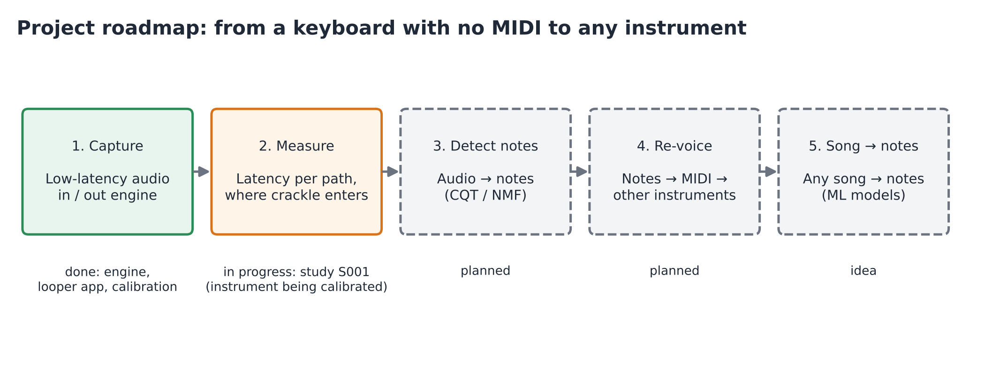
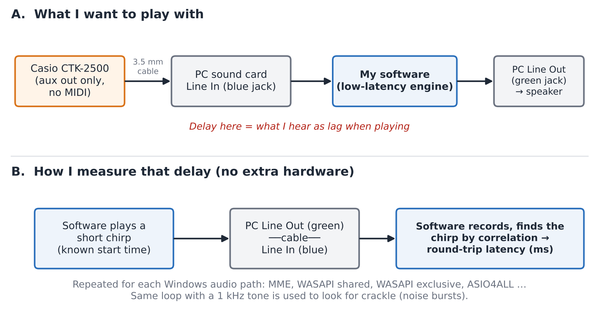
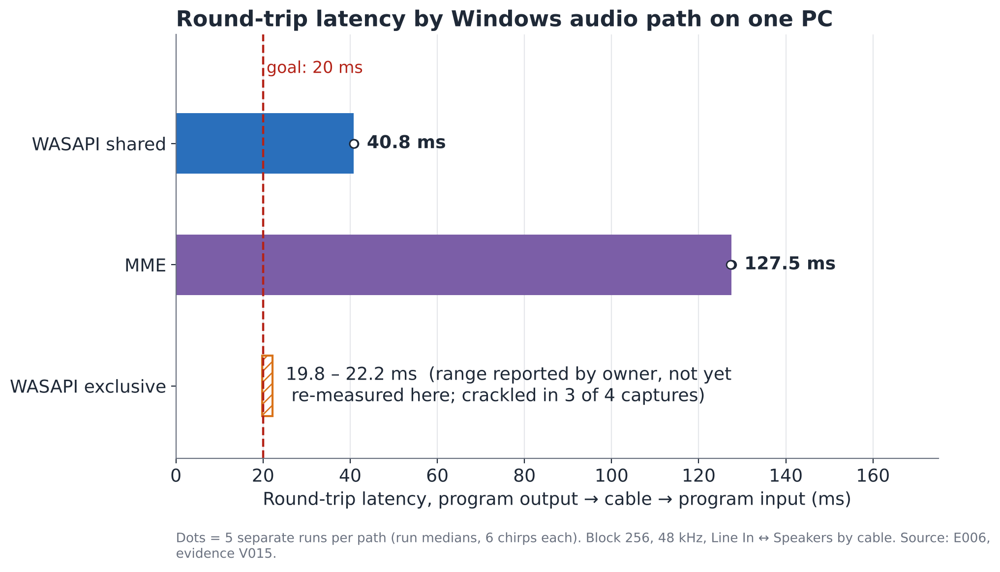
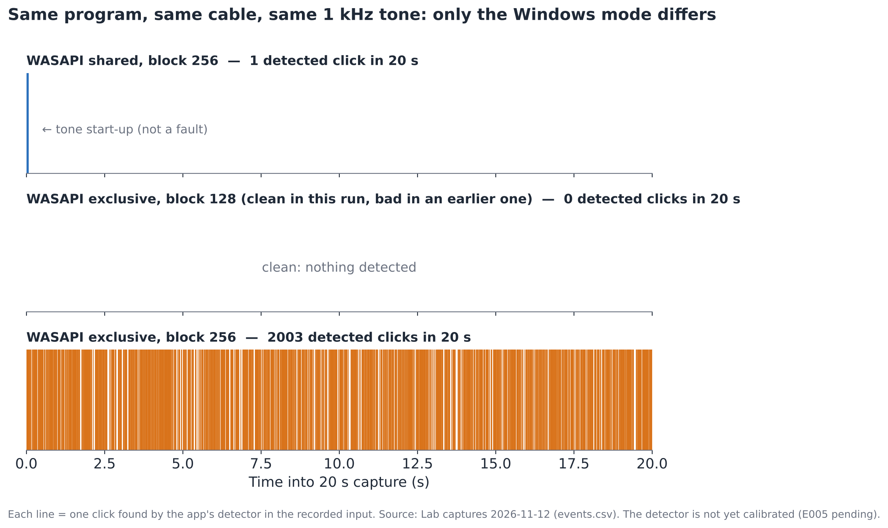
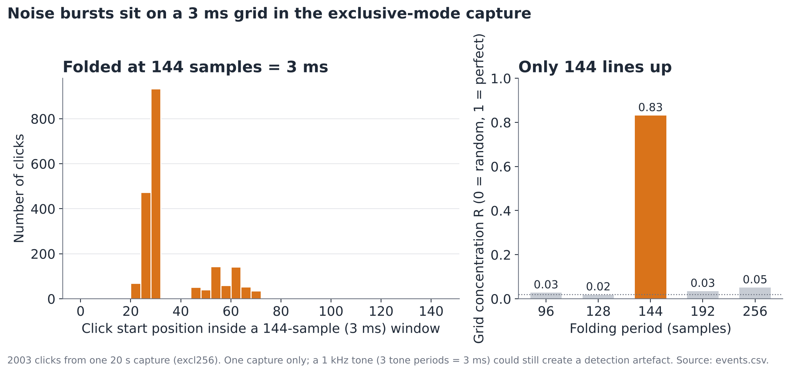
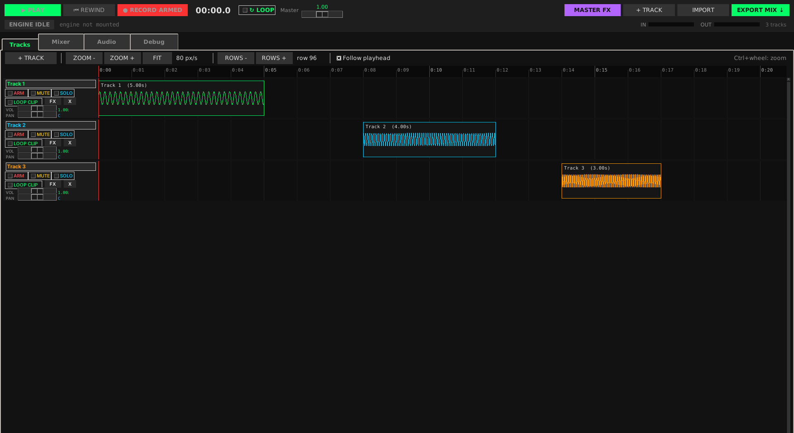

# Aux2Note

**A [Resonance Lab](https://github.com/resonance-lab-iiitr) project** · software-only music tech: low-latency audio capture → audio-to-notes (DSP) → song transcription (AI/ML) → new instrument voices.

`Live Looper Pro` is the first tool inside Aux2Note: a Windows looper and measurement app for low-latency audio on a normal PC.

> A student project to turn a Casio CTK-2500 (audio output only, no MIDI) into a live-looping instrument using **only software**: no audio interface, no extra hardware.
> Status: **work in progress.** Latency has been measured for two Windows audio paths; the fastest path still crackles. See [What is not done yet](#what-is-not-done-yet).

## The problem

I play a Casio CTK-2500. It has an aux output but no MIDI. I wanted to loop and re-voice what I play on my PC, like the live-looping reels online. When I connected the piano to the PC line-in and played through the speakers, the sound came back about **150–200 ms** late. That is too late to play in time.

Normal Windows audio is not built for low latency. Faster drivers (WASAPI exclusive, ASIO4ALL) cut the delay, but they gave me crackles and glitches when the buffer was small. So the first goal became:

> **Round trip of 20 ms or less with no crackle, on the PC I already have.**

## The test setup

To measure delay without extra hardware, the software plays a short chirp out of the green jack, a cable carries it into the blue jack, and the software finds the chirp in the recording by correlation. The time difference is the round-trip latency. The same loop with a 1 kHz tone is used to look for crackle.

## Results so far

### 1. Latency by Windows audio path

| Path | Round trip (median of 5 runs) | Spread of run medians | Crackle |
|---|---|---|---|
| MME | 127.5 ms (127.3–127.6) | 0.33 ms | clean |
| WASAPI shared | 40.8 ms (40.7–40.9) | 0.19 ms | clean |
| WASAPI exclusive | 19.8–22.2 ms, **owner-reported, not yet re-measured with this tool** | n/a | bad in 3 of 4 captures |

The MME value matches the 150–200 ms I felt on the first day. Shared and MME were clean in all 5 captures taken (2 MME, 3 shared); exclusive was bad in 3 of 4. Settings: block 256, 48 kHz, Line In to Speakers by cable, Microsoft HD Audio driver, High performance power plan.

### 2. Where the crackle comes from

Same program, same cable, same 1 kHz tone: WASAPI shared is clean, WASAPI exclusive at block 256 shows about 2,000 detected clicks in 20 s. The program's own output buffer was a perfect sine wave in all three Lab captures (error -152.5 dB), so the damage enters **after** the program's output: the driver, the sound card or the capture side. The data cannot say which.

The fault is intermittent: exclusive block 128 was bad in one session and clean in another.

### 3. A 3 ms pattern

The noise bursts line up on a 144-sample (3 ms at 48 kHz) grid. This suggests the driver works in fixed 3 ms periods. It rests on **one capture**, and a 1 kHz tone (3 periods = 3 ms) could produce a detection artefact, so it needs a second test tone frequency.

## The software

*(Screenshots are rendered by the automated GUI tests; replace with real-PC screenshots.)*

- Multi-track looper / mini DAW for Windows 10: Python 3.10, Tkinter, sounddevice, NumPy / SciPy.
- WASAPI exclusive engine with fallback ladder, in-app latency calibration, effects (EQ, compressor, distortion, delay, reverb), project files.
- **Lab tab**: records the raw sound-card input with per-block timing and finds clicks, dropouts, clipping and hum.
- Over 500 automated tests.

## What is not done yet

Being clear about this matters more than the headline numbers.

- **The measuring tools are not yet calibrated.** The latency analyser (E004) and the click detector (E005) have not been checked against known delays and injected bursts. All findings are marked *low confidence*.
- **The unplugged-cable control failed to run** (E006), so it is not yet shown that the cable is the only signal route.
- **WASAPI exclusive and ASIO4ALL have no formal latency measurement yet.**
- **The 20 ms goal is not met with clean audio.** The only path near 20 ms crackles.
- **Audio-to-MIDI is a plan, not a result.** No note detection has been built yet.

## What comes next

1. Calibrate the instruments (E004, E005) and repeat the unplugged control.
2. Measure exclusive, WDM-KS and ASIO4ALL with the same tool, then block size versus latency.
3. Find out whether any setting gives 20 ms **and** clean audio on this hardware.
4. Then: note detection from audio (constant-Q transform / NMF templates), mapping notes to other instruments, and later transcribing songs with ML models.

## Looking for collaborators

Resonance Lab brings together art and CSE. Help is welcome from:
- **Musicians** to test the looper and play it.
- **DSP and ML students** for note detection (constant-Q, NMF) and later song transcription.
- **Windows audio people** who know WASAPI, WDM-KS or ASIO drivers.

Open an issue to say hello.

## Repository layout

| Folder | What is in it |
|---|---|
| `CODE/` | The app, tools and tests |
| `RESEARCH/` | Study S001: hypotheses, experiments, evidence, findings, learning log |
| `DELIVERABLES/` | Task outputs, screenshots, the first crackle findings |
| `docs/` | Blog draft, LinkedIn draft, photo checklist |
| `figures/` | Images used here; `src/make_figures.py` rebuilds them from the evidence files |

Rebuild the figures: `python3 src/make_figures.py <PROJECT folder> figures`

## How this was made (authorship)

I (the owner) built the setup, ran every measurement on my PC, set the goals and made the decisions. I used **Claude (an AI assistant)** for study design, analysis scripts, much of the code and the write-up. Claude cannot hear audio or touch the PC; every number comes from files my PC produced. Raw recordings stay on my PC.

## Author

Dhanlobhe Hrishikesh Manojkumar, CSE, IIIT Raichur · [LinkedIn](https://www.linkedin.com/in/dhanlobhe-hrishikesh-manojkumar-5830a3390/) · cs25b1014@iiitr.ac.in
